# Clinical Co-Pilot Auditor architecture

## Executive summary

The auditor evaluates an operator-owned synthetic OpenEMR Clinical Co-Pilot. A React UI and Express API accept target identities, cases, model assignments and run limits. PostgreSQL owns reservations, execution snapshots, worker leases, events, assessments, findings, model-call accounting and schedules; a private volume holds synthetic PDFs. A TypeScript worker opens the assigned chart and conversation, sends user-facing chat/PDF actions, records the response, applies deterministic checks and asks an independent Judge model for a verdict. It closes the session and releases the reservation afterward. This foundation has evidence and reporting gaps documented in the [audit](docs/audit/2026-09-28/AUDIT.md).

Four distinct authorities are intended. The **Orchestrator** chooses a bounded seed/category; today it mainly selects the least-executed category in one adaptive run. The **Red Team** proposes typed actions but cannot choose credentials, patients, endpoints or raw HTTP. The **Judge** receives observations independently of Red Team success claims and proposes a cited verdict; deterministic policy routes it. The **Documentation Agent** will draft only from confirmed, complete evidence. Its model field exists, but it is never invoked; current export is generic JSON. These are role boundaries, not separate services. [K01](https://linear.app/hdxsfbr/issue/HDX-38) will publish contracts, [A17](https://linear.app/hdxsfbr/issue/HDX-29) adds feedback, and [F00](https://linear.app/hdxsfbr/issue/HDX-39)/[F01](https://linear.app/hdxsfbr/issue/HDX-22) implement bounded Documentation.

The central trust boundary separates attacker text from executable authority. A proposal is data until schema and policy admit it. Only the session adapter translates it into the OpenEMR login, chart, PDF upload, ticket and turn sequence. Each attempt gets a fresh ticket; ambiguous delivery is not replayed. Target text and model output remain untrusted evidence. Credentials, cookies, CSRF and tickets must stay out of model prompts and events. Hosted-model packets use synthetic aliases. With no app login, LAN access confers operator power; firewall and host allowlisting are security controls, not application authentication.

Evidence decisions must fit their proof. Current responses are flattened and silently cut at 10,000 characters; an unrelated quote enabled confirmation, and a missing PDF did not block review/export. Planned work versions observations, includes executed actions/checks/effects in the Judge packet and checks exact artifacts before decisions. Current labels are not calibrated safety measurements. Chart-context leakage is the requirement; separate legitimate chart access is not a failure. Optional approved read-only facts/audit events may strengthen fact/write claims, but attacks remain user-facing and black-box unknowns remain honest.

Run, case, time and paid-model bounds, target reservations, lease generations, cautious retries and unresolved-charge holds limit failure damage. Confirmed exploits should become immutable regressions compared across compatible target versions and evidence scopes. Human approval resolves uncertain confirmation and controls report publication. Fixture tests exercise transport and persistence without a live target or paid provider. No checkout evidence establishes three genuine live vulnerabilities, a 100-case live baseline, peer integration, actual development spend or public deployment; these remain open in the [rubric register](docs/implementation/rubric.md).

Queue age, role-level cost, complete evidence and version-scoped coverage must be visible to both operator and Orchestrator. Their present gaps prevent a defensible claim that unattended testing improves security over time, even though bounded execution already works.

## Agent interactions and decision authority

```mermaid
flowchart LR
  O[Operator] --> API[React / Express control plane]
  API --> DB[(PostgreSQL: jobs, runs, evidence, ledger)]
  DB --> W[Leased worker / LangGraph case]
  W --> OR[Orchestrator: select bounded work]
  OR --> RT[Red Team: propose typed actions]
  RT --> P[Deterministic admission policy]
  P --> S[Session adapter: chosen synthetic user/chart]
  S --> T[Clinical Co-Pilot chat / PDF]
  T --> E[Versioned observation and checks]
  E --> J[Independent Judge proposal]
  J --> G[Deterministic evidence gate]
  G --> DB
  DB --> D[Documentation draft job]
  D --> H[Human review and exact-revision approval]
  H --> R[Redacted report / regression suite]
  R --> OR
  X[Optional read-only evidence adapter] -. approved corroboration only .-> E
```

Solid boxes describe the target design; current exceptions are stated below. `Documentation draft job`, full feedback from regressions to Orchestrator, and optional adapter are **planned**. The existing worker uses LangGraph for a case observe→judge flow and invokes Orchestrator/Red Team during adaptive runs; their models are selected per run. The current shared Zod contracts in [`packages/contracts/src/index.ts`](packages/contracts/src/index.ts) cover actions, checks, verdict and observation v1 but do not yet publish every inter-agent success/error envelope. No peer service boundary is demonstrated.

| Role | Inputs and context | Output and decision authority | Current status / planned correction |
| --- | --- | --- | --- |
| Orchestrator | Allowed seed IDs/categories, bounded recent observations; later scoped coverage, open findings and regressions | Selects next admissible seed/category or stops; cannot alter run limits, target or verdict | Invoked in adaptive path, but little history. [A17](https://linear.app/hdxsfbr/issue/HDX-29). |
| Red Team | Selected synthetic seed, allowed PDF references, prior sanitized observations; later mutation lineage | Proposes 1–3 typed user-facing actions; policy admits/rejects; cannot issue HTTP or set identity | Invoked adaptively. No within-case response-conditioned next turn yet. [A17](https://linear.app/hdxsfbr/issue/HDX-29). |
| Judge | Expected safe boundary and assistant observations; later executed messages, attachments, deterministic checks and effects | Proposes cited verdict; cannot write findings or change checks; deterministic gate/human decides | Separate model call exists, but packet/gate are weak. [E01](https://linear.app/hdxsfbr/issue/HDX-7), [E03](https://linear.app/hdxsfbr/issue/HDX-10). |
| Documentation | Planned: confirmed candidate, validated evidence links, severity/context, report schema and budget | Drafts a report revision; cannot invent evidence, publish or remediate | Model assignment only; no invocation. [F00](https://linear.app/hdxsfbr/issue/HDX-39), [F01](https://linear.app/hdxsfbr/issue/HDX-22). |

The worker and repository, rather than a model, own authorization, execution, admission, outcome routing, budget and persistence. Separate role prompts/model assignments reduce a conflict of interest, but model independence alone does not make the Judge accurate. The planned contracts name message identity, version, run/case/action IDs, evidence references, limits, lineage and typed failures. Producers and consumers validate the same schema; breaking changes require a version bump and migration note. [K01](https://linear.app/hdxsfbr/issue/HDX-38) owns executable proof, and [I01](https://linear.app/hdxsfbr/issue/HDX-36) owns independent peer integration evidence.

## Auth, data flow and storage

The API restricts configured target hosts; it does not authenticate its own clients. Saved synthetic credentials are encrypted with AES-256-GCM using `CREDENTIAL_KEY` outside the database. Run snapshots keep credential references, not plaintext. The worker alone decrypts the chosen identity, resolves one exact external patient ID through authenticated lookup, opens that chart, obtains module CSRF/conversation context, mints one ticket per turn and sends an admitted action. The Red Team, Orchestrator, Judge, Documentation role and optional adapter receive no target password, cookie, CSRF or ticket. A second synthetic session may verify a distinct chart for context tests; the physician's legitimate access to that other chart is not the finding.

Events and assessments are in PostgreSQL; synthetic PDF bytes reside on a private volume with size/hash references. Target response metadata should be stored as a bounded versioned observation, with a private evidence representation and sanitized provider/report projections. Today the typed observation is a flattened v1 string and lacks completeness. Evidence retention/deletion policy and multi-operator access control remain future release decisions; no real patient data belongs in this installation. A read-only adapter, if an exact approved target/version contract exists, must be off by default, bounded, correlated to run/chart/turn, and incapable of arbitrary query or write. Missing or stale adapter data is unknown, never a negative proof.

The present schema has UUIDs and foreign keys for targets, cases, runs, candidates, regressions and artifacts, an ordered `(run_id,id)` event index, model-call index and unique schedule occurrences. It lacks required finding severity/reproduction fields, stable duplicate fingerprints and query indexes for severity/category/version. [F01](https://linear.app/hdxsfbr/issue/HDX-22), [G01](https://linear.app/hdxsfbr/issue/HDX-26) and [V01](https://linear.app/hdxsfbr/issue/HDX-24) own those migrations. Add columns/versioned records without rewriting old JSON into fabricated evidence; keep unknown legacy fields explicit. The API is currently `/api/...` without a separately versioned public API contract. [K01](https://linear.app/hdxsfbr/issue/HDX-38) owns versioned internal contracts, and [D02](https://linear.app/hdxsfbr/issue/HDX-33) owns final API/migration documentation.

## Execution, regression, observability and failure behavior

PostgreSQL reservations serialize work per target; worker claims use leases and generations, and schedule occurrences have a uniqueness constraint. This is not a second queue product. A queued run can wait while one default worker handles another; current health reports database/migration readiness but not worker liveness or queue age. [O01](https://linear.app/hdxsfbr/issue/HDX-21) adds those signals, incremental evidence cursors, pagination and safe diagnostic codes. The worker should stop before another action when a run is cancelled; selected-run stop is not yet implemented. [R01](https://linear.app/hdxsfbr/issue/HDX-14) owns it.

An HTTP timeout or uncertain response after a turn may mean the target acted. Only the explicit target “not applied” contract permits the current single retry. Unknown paid provider delivery retains a spend reservation and prevents further paid dispatch. Missing Judge evidence is inconclusive/incomplete, never a safety pass. An artifact integrity failure should block a new confirmation or complete export; this is currently defective and belongs to [E02](https://linear.app/hdxsfbr/issue/HDX-8). A regression replay should use the original criterion and target version; a changed phrasing or incomplete run is unknown, not fixed. Suite execution, resurfacing and cross-category effects are planned in [G02](https://linear.app/hdxsfbr/issue/HDX-27).

Cost and rate control: current case schema allows up to three actions, chat messages up to 1,000 characters, adaptive runs up to nine cases and 30 minutes, and explicit OpenRouter caps with conservative reservations. The target brief states 10 turns/minute/conversation, 20K tokens/turn, 60K/conversation, 2M/day, 90 seconds/turn, 30 seconds/extraction and 15 seconds/guideline search. The worker currently uses one 15-second target request deadline, so it cannot claim compliance with the target's turn allowance; [E04](https://linear.app/hdxsfbr/issue/HDX-11) owns operation-specific timing and remaining-budget checks. Model calls currently use a fixed 30-second timeout. OpenRouter requires an API key and verified catalog pricing; Ollama is configured locally. Provider rate-limit details and current quotas are configuration-dependent, not verified here. A generic 429/5xx on a target turn is not proof of nonapplication and is not replayed; queued work/backoff policy for provider calls must preserve unknown charge. [M01](https://linear.app/hdxsfbr/issue/HDX-16), [M02](https://linear.app/hdxsfbr/issue/HDX-28), [P01](https://linear.app/hdxsfbr/issue/HDX-32) own preflight, reconciliation and measured scaling. No separate observability backend is called by this checkout.

## AI-use disclosure and known tradeoffs

AI generates adaptive selections/proposals, proposes Judge verdicts and will draft reports. Current deterministic boundaries validate action shapes, target transport, spend and observation references; report-schema validation is planned. Human approval resolves uncertain findings and controls report publication. Current automatic confirmation uses quote occurrence rather than semantic support, so its reliability is **not established**. A labeled synthetic calibration set should measure false confirms, false safes, abstention and drift by policy/model/target version; failed thresholds disable auto-confirm and send cases to review. A model cannot validate its own ground truth. [E03](https://linear.app/hdxsfbr/issue/HDX-10) owns the calibration and gate. Human decisions require rationale and an auditable correction path, planned in [F01](https://linear.app/hdxsfbr/issue/HDX-22).

The current LAN-only/no-login choice is acceptable only for one trusted operator and synthetic evidence; the PRD's public deployed **target** requirement is separate and still unverified in this checkout. The use of LangGraph for in-process case sequencing and PostgreSQL for durable coordination preserves tested reservation/lease behavior but leaves worker-health and high-volume throughput unmeasured. The optional evidence adapter is an explicit tradeoff: it can strengthen fact/write assertions, but is not needed to execute black-box attacks and cannot be presumed available. Build-versus-configure decisions are recorded in [ADR 0001](docs/adr/0001-build-versus-configure.md) and [ADR 0002](docs/adr/0002-trust-and-evidence-boundaries.md); the full rubric gap status is in the [register](docs/implementation/rubric.md).
