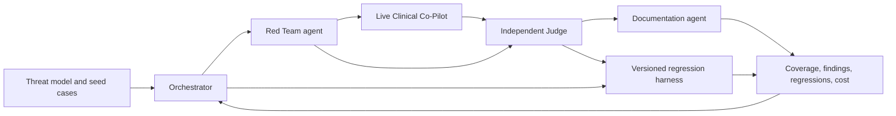

# Research: Clinical Co-Pilot adversarial platform baseline

**Date**: 2026-09-28T11:28:30-07:00
**Git Commit**: `4f9c267db4bef64ada3816b9ba978753fc3f575a`
**Branch**: `multi-model-llm-integration-platform-gv6ruh`
**Repository**: `copilot-security-auditor`

## Research Question

1. Which project materials exist in this checkout and on `main`, and how does the documented Clinical Co-Pilot and multi-agent evaluation target compare with implemented code?
2. Which application, deployment, live-target, fixture, credential, and CI/test infrastructure exists, and which prerequisites are only specified in the PRD?
3. Which adversarial, OWASP, transcript, verdict, exploit, regression, message/error, approval, and coverage/cost artifacts or schemas exist, and how do the PRD and lecture notes connect them?
4. What do the official OpenRouter, Ollama, and Unsloth Studio documents specify about requests, authentication, streams, models, limits, and usage/cost, and is any of it used in this repository?
5. What do official Codex CLI and Claude Code documents specify about automation, output, sessions, permissions, authentication, and billing, and are the CLIs configured here?
6. What frontend conventions exist, and which observability surfaces and visual properties are actually stated in project materials?

## Research Methodology (verbatim)

This document will remain objective and factual. It does not contain any recommendations or implementation suggestions.
Open questions will not ask Why things haven't been built or what should be built in the future.

There is no "implementation" section - that is intentional.

## Summary

The checkout and local `main` are materially different document snapshots, not an application plus its docs. At the recorded commit, the checkout tracks only a generic GitLab `README.md`; a `.gitignore` is untracked. Local `main` instead tracks a one-line README and three `docs/` files: the 18-page AgentForge PRD, lecture notes, and a slide PDF. Neither tree contains the Clinical Co-Pilot, an adversarial runner, a UI, a deployment definition, a test suite, or provider configuration. The local refs have no merge base; describing the `main` PRD as present in this checkout would be inaccurate (`README.md:1-9`; `main:README.md:1`; `main:docs/Week 3_AgentForge_PRD.pdf`, PDF pp. 1-2).

The PRD describes a live, locally runnable and deployed OpenEMR Clinical Co-Pilot and a distinct Orchestrator, Red Team, Judge, and Documentation agent system. Seed cases produce live observations; the independent Judge evaluates them; confirmed exploits feed professional findings and versioned regression cases; coverage, status, sequence traces, and costs inform the Orchestrator. Those are documented requirements, not running behaviors (`main:docs/Week 3_AgentForge_PRD.pdf`, PDF pp. 7-13).

Official provider and CLI documentation offers several different wire and execution contracts: OpenRouter uses hosted Bearer-authenticated Chat Completions and SSE; Ollama has native NDJSON plus a subset of `/v1` compatibility, with different local/cloud authentication; Unsloth Studio exposes keyed local compatibility routes separate from its training app API. Codex and Claude Code each have distinct machine-readable, session, permission, and billing semantics. The repository contains no integration for any of them (official sources linked in sections 4-5; checkout and `main` trees described in section 1).

## Detailed Findings

### 1. The local refs contain project requirements on `main`, but no application in either tree

The current checkout's `README.md` is a 94-line GitLab starter page, with generic test/deploy links rather than project commands (`README.md:1-9`, `README.md:35-43`). Its only other visible root file is an untracked `.gitignore` that excludes `.humanlayer/tasks/` (`.gitignore:1-6`). Local `main` at `d78ada9e70397be845bca95c60afa49bab5b99c9` contains the one-line title `Copilot security auditor` and the three documents below. The `documents folder` named in the research context is not in either tree; the PRD lives on `main` under `docs/`, not in the working tree. This inventory refers only to this repository; task artifacts are outside the tracked product tree.

```text
checkout HEAD (4f9c267)
├── README.md                         generic GitLab starter, tracked
└── .gitignore                        task-artifact ignore rules, untracked

local main (d78ada9)
├── README.md                         one-line project title
└── docs/
    ├── Week 3_AgentForge_PRD.pdf     18-page project requirements
    ├── LECTURE_NOTES.md              security lecture summary
    └── LECTURE_SLIDES.pdf            15-page visual slide deck
```

The PRD calls the intended platform AgentForge and describes an OpenEMR chatbot tied to patient and operational data for chart lookup, note summarization, intake, and clinical operations; uploaded content, multi-turn conversations, tools, and retrieval are part of its threat context (`main:docs/Week 3_AgentForge_PRD.pdf`, PDF pp. 2-3). The lecture frames this as untrusted input becoming trusted-looking output and locates other controls outside the model pipeline, including auth, perimeter, validation, and tool scoping (`main:docs/LECTURE_NOTES.md:5-10`). None of these descriptions supplies an implemented OpenEMR instance or an endpoint contract in this repository.

| Area | Documented on `main` | Observed in checkout and `main` trees |
| --- | --- | --- |
| Live target | Locally runnable and publicly deployed Clinical Co-Pilot, deployed URL with each checkpoint; real live tests, not a mock (PRD pp. 7-8, 14) | No target URL, route, auth flow, server, or OpenEMR configuration |
| Application and delivery | Multi-agent platform, observability, README setup/deployed link (PRD pp. 9-11, 14) | No source, manifests, Docker/Compose, package manager, dependencies, CI workflow, or deployment config; checkout README has only generic GitLab links (`README.md:35-43`) |
| Test data and evidence | Threat map, three-category `./evals/`, vulnerability reports, `/contracts`, regression and contract tests (PRD pp. 8-14) | No fixtures, tests, schemas, snapshots, harness, or results |
| Credentials | Agent-to-target authorization model and external API auth/rate-limit documentation (PRD p. 13) | No `.env`, secret config, key mapping, or credential implementation |
| Operator UI | Human-visible findings, trends, agent execution sequence, cost (PRD p. 11) | No web app, components, assets, stylesheets, or design tokens |

#### Testing patterns

No test files, fixtures, framework configuration, CI execution, or mock server exist in either ref. The PRD specifies live initial evals (`./evals/`, PDF pp. 8-9), repeated regression runs (p. 11), producer/consumer contract tests (p. 12), a CI performance SLO and 100-case load run (p. 13); those are prospective test descriptions, not test results.

### 2. The documented evaluation loop separates attack generation, judgment, reporting, and prioritization

The PRD explicitly rejects a single agent or a simple single-context pipeline as its target architecture. The Orchestrator selects work from coverage gaps, severe open findings, and recent regressions; the Red Team generates and mutates single- and multi-turn attacks against the live target; the independent Judge decides whether attack, defense, or regression criteria held; the Documentation Agent converts confirmed findings into reproducible vulnerability reports (`main:docs/Week 3_AgentForge_PRD.pdf`, PDF pp. 4-5, 9-11). This diagram expresses the described responsibilities, not implemented calls:



The Stage 2 threat map enumerates direct, indirect, and multi-turn injection; PHI and cross-patient leakage and authorization bypass; history/context poisoning; unintended/recursive tool invocation and parameter tampering; token/loop/cost denial of service; and identity/role/trust-boundary abuse. Each category is to record surface, impact, exploitation difficulty, and defenses (`main:docs/Week 3_AgentForge_PRD.pdf`, PDF p. 8). The lecture adds RAG document injection, PII redaction, prompt leakage, and excessive tool agency as contextual examples (`main:docs/LECTURE_NOTES.md:15-24`, `main:docs/LECTURE_NOTES.md:55-59`). The lecture's GPT-4.1/GPT-5 indirect-injection demonstration is a reported classroom example, not a result from this repository (`main:docs/LECTURE_NOTES.md:55-59`).

The described data handoffs can be summarized without inventing a concrete schema:

| Evidence object or boundary | Fields, rules, or signals actually stated | Current artifact |
| --- | --- | --- |
| Seed/live eval case | Category/subcategory, specific prompt or input sequence, expected safe behavior, observed pass/fail/partial behavior, severity/exploitability, regression inclusion; mapping to OWASP (PRD pp. 8, 12) | No `evals/` or cases |
| Multi-turn transcript | Input sequence is required, and multi-turn probing is required; no transcript envelope, role list, conversation ID, or turn serialization is defined (PRD pp. 8, 10) | No transcript schema or fixtures |
| Judge verdict | Independent determination of attack success, defense, regression; consistent criteria and independent verification of drift are required, but no verdict JSON fields or confidence threshold is specified (PRD pp. 4-5, 10, 13) | No judge or verdict records |
| Confirmed exploit | Versioned/queryable record, unique identifier, severity, attack category, reproduction steps, observed and expected behavior, no duplicate attack sequences (PRD pp. 11, 13) | No exploit database or report files |
| Regression replay | Confirmed exploit converted to repeatable evaluation; detects resurfaced fixes and cross-category regressions; Orchestrator triggers runs (PRD p. 11) | No harness, replay logs, or system-version history |
| Agent message | Typed Orchestrator-to-RedTeam, RedTeam-to-Judge, Judge-to-Documentation contracts; versioned `v1` or higher, producer/consumer contract tests and migration notes (PRD pp. 12-13) | No `/contracts`, message definitions, or contract tests |
| Agent error | Typed target-unreachable, budget-exceeded, judge-timeout, no-findings-in-window, and regression-detected responses; no field names or status codes supplied (PRD p. 13) | No error schemas |
| Coverage/cost trace | Category counts, per-version pass/fail and resilience trends, finding status, run cost/rate, agent actions and order, agent-level cost context (PRD pp. 11, 17) | No telemetry backend, traces, dashboards, or pricing ledger |

Each case is also required to exercise a boundary, an invariant, or a regression risk; the PRD names the invariant that the Judge must not approve a confirmed successful exploit (`main:docs/Week 3_AgentForge_PRD.pdf`, PDF p. 12). The OWASP mapping spans conventional risks (broken access control, injection, insecure design, vulnerable components, authentication/logging failures, SSRF) and LLM risks (prompt injection, insecure output handling, sensitive-information disclosure, excessive agency, supply chain). The PRD requires a case-level mapping but does not publish category identifiers or a mapping file (`main:docs/Week 3_AgentForge_PRD.pdf`, PDF p. 12). The lecture says the OWASP LLM Top 10 is a starting checklist (`main:docs/LECTURE_NOTES.md:11-12`).

The report boundary is more detailed than the wire boundary: the Documentation Agent's required report contains ID, severity, clinical impact, minimal reproduction, observed versus expected result, remediation approach, status, and fix-validation result (`main:docs/Week 3_AgentForge_PRD.pdf`, PDF pp. 10-11). The PRD calls for explicit human approval before publishing findings, agent read/write permissions over exploits, and trust decisions around filing and remediation, but does not assign an implemented approval policy (`main:docs/Week 3_AgentForge_PRD.pdf`, PDF pp. 5, 9, 13). Lecture notes separately describe review of flagged actions, logging for reversible/two-way-door actions, and blocking destructive actions (`main:docs/LECTURE_NOTES.md:43-47`). The note that LangSmith under a BAA can receive full prompts for this assignment is lecture guidance, not evidence of a LangSmith integration (`main:docs/LECTURE_NOTES.md:51-53`). Cost controls discussed in the lecture include rate limits, circuit breakers, gateway token budgets, and alerts in response to inference DoS and full-history replay (`main:docs/LECTURE_NOTES.md:29-35`).

#### Testing patterns

No repository tests currently exercise this flow. Documented validation consists of three-category live eval results (PRD pp. 8-9), independent Judge evaluation and repeated regression checks (pp. 4-5, 11), schema contract tests across agent boundaries (p. 12), and a cross-agent end-to-end trace plus a 100-case load exercise (pp. 12-13). There are no local mocks, seeded datasets, or fixture utilities to describe.

### 3. The PRD specifies observable facts but no product UI or visual design system

The operator-facing observability questions are explicit: category/case coverage, per-category and per-version pass/fail, resilience trend, open/in-progress/resolved findings, test-run cost and scaling rate, and what each agent did in temporal order. The same signals form the Orchestrator's data substrate (`main:docs/Week 3_AgentForge_PRD.pdf`, PDF pp. 5, 11-12). The submission evidence additionally includes architectural/data-flow diagrams, agent authorization, dependency versions, scan results, eval evidence, a sample incident/postmortem, and development versus projected spend at 100, 1K, 10K, and 100K runs (`main:docs/Week 3_AgentForge_PRD.pdf`, PDF pp. 13-14). No dashboard route, frontend component, tracing backend, or UI state contract exists in either repository ref.

The PDFs are presentation material, not a CSS specification. Visually, the PRD uses light pages and blue-accented headings/tables/callouts; the slide deck uses dark backgrounds, light headings, muted cards, and colored risk/coverage accents (`main:docs/Week 3_AgentForge_PRD.pdf`, PDF pp. 7-13; `main:docs/LECTURE_SLIDES.pdf`, PDF pp. 1-15). Neither declares color hex codes, typeface names, a typographic scale, numeric spacing, border widths/radii, shadow tokens, or a supported light/dark theme contract. The slide PDF has no extractable text in a text-layer pass, so these observations are visual descriptions, not named tokens. The checkout README's generic `Visuals` paragraph is GitLab boilerplate, not a design convention (`README.md:64-65`).

#### Testing patterns

No frontend, visual snapshots, browser tests, accessibility tests, or telemetry/UI tests exist. The PRD's observability checklist is a set of required operator questions rather than an executable acceptance suite (`main:docs/Week 3_AgentForge_PRD.pdf`, PDF p. 11).

### 4. Official provider APIs expose different authentication, stream, discovery, and metering contracts

The following table describes provider documentation as of the research date; it does not describe integrations in this repository. OpenRouter and Ollama offer Chat Completions-compatible paths, while Ollama's native API uses different streaming; Unsloth Studio has a separate training-app API and an inference compatibility interface. There are no provider client libraries, keys, base URLs, model IDs, or model-selection configuration in either ref.

| Service | Requests, responses, authentication | Streaming and model discovery | Limits and usage/cost |
| --- | --- | --- | --- |
| OpenRouter | `POST https://openrouter.ai/api/v1/chat/completions`, Bearer API key, `messages` or `prompt` and optional `model`; normalized `choices[].message`, `usage`; optional application attribution headers ([API reference](https://openrouter.ai/docs/api_reference/overview), [auth](https://openrouter.ai/docs/api_reference/authentication)) | `stream: true` SSE with `choices[].delta`, possible comment keepalives, terminal usage frame before `[DONE]`; `GET /api/v1/models` exposes IDs, context, parameters, provider limits and pricing ([streaming](https://openrouter.ai/docs/api_reference/streaming), [models](https://openrouter.ai/docs/api/api-reference/models/list-all-models-and-their-properties)) | Key/spend limits and `429` rate-limit headers; free-model tier limits are documented separately; completion usage includes token counts and optional credit cost, generation lookup exposes historical cost, credits/key endpoints expose account/key spend ([limits](https://openrouter.ai/docs/api_reference/limits), [usage](https://openrouter.ai/docs/api_reference/overview), [generation](https://openrouter.ai/docs/api/api-reference/generations/get-request-&-usage-metadata-for-a-generation)) |
| Ollama | Native `POST /api/chat` (`model`, `messages`) and `/api/generate` (`model`, `prompt`) return `message`/`response` and timing/token metadata; local `http://localhost:11434/api` has no auth, cloud `https://ollama.com/api` requires Bearer `OLLAMA_API_KEY`; `/v1` offers a documented OpenAI-compatible subset ([intro](https://docs.ollama.com/api/introduction), [chat](https://docs.ollama.com/api/chat), [generate](https://docs.ollama.com/api/generate), [auth](https://docs.ollama.com/api/authentication), [compatibility](https://docs.ollama.com/api/openai-compatibility)) | Native endpoints default to NDJSON; `stream: false` gives one JSON object; local `GET /api/tags` lists installed models and `/api/ps` loaded models, and cloud tags lists hosted IDs. `/v1/models`, chat/completions, embeddings, and stateless Responses are in the compatible subset; stateful `previous_response_id`/`conversation` are not supported ([streaming](https://docs.ollama.com/api/streaming), [tags](https://docs.ollama.com/api/tags), [compatibility](https://docs.ollama.com/api/openai-compatibility)) | Native response usage is token counts and duration, not currency; cloud account usage and published pricing are separate. Cloud plan concurrency is published as Free 1, Pro 3, Max/Team 10; the fetched API docs do not specify numeric RPM/RPD or rate-limit headers ([usage](https://docs.ollama.com/api/usage), [cloud](https://docs.ollama.com/cloud), [pricing](https://ollama.com/pricing)) |
| Unsloth Studio | Local browser app for chat, training, and model export; its separately authenticated inference interface has `POST /v1/chat/completions` (`model`, `messages`), `/v1/responses` (`model`, `input`), and `/v1/messages` (`model`, `messages`, `max_tokens`); every call uses `Bearer sk-unsloth-...` ([Studio](https://unsloth.ai/docs/new/studio), [HTTP](https://unsloth.ai/docs/integrations/connect-curl-and-http-to-unsloth), [API](https://unsloth.ai/docs/basics/api)) | Non-streaming JSON or `stream: true` SSE; chat sends delta chunks then `[DONE]`, Messages uses named Anthropic events and optional custom tool-result events. `GET /v1/models` lists currently loaded local models; the Studio application also documents distinct JWT-authenticated `/api/*` training/status/metrics/stream routes ([HTTP](https://unsloth.ai/docs/integrations/connect-curl-and-http-to-unsloth), [Studio workflow](https://unsloth.ai/docs/new/studio/start)) | API monitor displays tokens, latency, TTFT, throughput, errors; training UI displays training/GPU metrics. The consulted official docs specify no inference monetary-cost response field, price schedule, RPM/RPD quota, or rate-limit headers for the local interface ([API](https://unsloth.ai/docs/basics/api), [Studio](https://unsloth.ai/docs/new/studio)) |

An illustrative boundary shape, drawn from those official references rather than from repository code:

```text
OpenRouter: POST /api/v1/chat/completions + Bearer key -> JSON choices/usage OR SSE delta/usage/[DONE]
Ollama native: POST /api/chat + model/messages -> NDJSON by default, final done=true; local unauthenticated
Unsloth inference: POST /v1/chat/completions + Bearer sk-unsloth-* -> JSON OR SSE delta/[DONE]
Unsloth app: /api/train/* and /api/train/metrics -> separate JWT-authenticated Studio operations
```

OpenRouter's optional `usage.cost` is described in credits in its completion response, while its generation metadata provides a USD total; these should not be conflated ([OpenRouter reference](https://openrouter.ai/docs/api_reference/overview), [generation metadata](https://openrouter.ai/docs/api/api-reference/generations/get-request-&-usage-metadata-for-a-generation)). Ollama's `/v1` low-level SSE framing and Unsloth's exhaustive `/api/*` payload schemas are not established by the consulted references, beyond their documented compatibility/examples ([Ollama compatibility](https://docs.ollama.com/api/openai-compatibility), [Unsloth Studio workflow](https://unsloth.ai/docs/new/studio/start)).

#### Testing patterns

No provider integration or contract tests, stream fixtures, mocked HTTP responses, live smoke tests, or credential-validation tests exist locally. The PRD requires external API auth/rate-limit documentation and agent-level cost visibility, but supplies no configured provider test harness (`main:docs/Week 3_AgentForge_PRD.pdf`, PDF pp. 11, 13).

### 5. Codex and Claude Code support scripted runs, but their auth and permission defaults differ

Official CLI documentation describes automation interfaces, not code present here. No Codex or Claude CLI invocation, settings file, agent instruction file, session fixture, CI step, or project-specific credential configuration is in either repository ref. The global interactive environment is not a repository integration.

| Behavior | Codex CLI | Claude Code |
| --- | --- | --- |
| Non-interactive call | `codex exec "prompt"`; progress on stderr, final response on stdout ([OpenAI: non-interactive mode](https://developers.openai.com/codex/non-interactive-mode)) | `claude -p "prompt"`; output as text by default, exit status signals failure ([Anthropic: programmatic usage](https://code.claude.com/docs/en/headless)) |
| Structured output | `--json` emits lifecycle JSONL with thread ID and `item.*`/turn events; `--output-schema` constrains final response; `-o` writes final message ([OpenAI: non-interactive mode](https://developers.openai.com/codex/non-interactive-mode)) | `--output-format json` includes result/session metadata; `stream-json` emits events; `--json-schema` produces `structured_output` ([Anthropic: programmatic usage](https://code.claude.com/docs/en/headless), [CLI reference](https://code.claude.com/docs/en/cli-reference)) |
| Session continuation | Saved run by default, `--ephemeral` prevents saved rollout; `codex exec resume --last` or `<SESSION_ID>` ([OpenAI: non-interactive mode](https://developers.openai.com/codex/non-interactive-mode)) | `--continue`, `--resume <session-id-or-name>`; `--no-session-persistence` disables print-mode saving ([Anthropic: programmatic usage](https://code.claude.com/docs/en/headless)) |
| Permissions | `exec` starts read-only; `--sandbox workspace-write` or `danger-full-access`; sandbox and approval policy are separate controls ([OpenAI: non-interactive mode](https://developers.openai.com/codex/non-interactive-mode), [approvals](https://developers.openai.com/codex/agent-approvals-security)) | `-p` starts in Manual; `--allowedTools`/permission modes govern approvals; `--permission-prompts none` denies unresolved interactive requests ([Anthropic: programmatic usage](https://code.claude.com/docs/en/headless), [permissions](https://code.claude.com/docs/en/permissions)) |
| Authentication and billing | ChatGPT sign-in uses plan allowance; API-key sign-in is usage-billed to the Platform account. `exec` reuses saved credentials, or `CODEX_API_KEY` supplies a per-invocation API key; `codex login status` identifies active method. Docs do not publish a complete simultaneous-credential precedence order ([OpenAI: auth](https://developers.openai.com/codex/auth), [non-interactive mode](https://developers.openai.com/codex/non-interactive-mode), [pricing](https://developers.openai.com/codex/pricing)) | Credential precedence: selected cloud provider, `ANTHROPIC_AUTH_TOKEN`, `ANTHROPIC_API_KEY`, `apiKeyHelper`, `CLAUDE_CODE_OAUTH_TOKEN`, profiles/federation, then subscription `/login` OAuth, with gateway/policy exceptions. `-p` uses an API key when present; subscription use and API-billed usage are different paths ([Anthropic: auth](https://code.claude.com/docs/en/authentication), [costs](https://code.claude.com/docs/en/costs)) |

Claude Code's `--bare` also omits subscription OAuth and keychain credentials as well as automatic project integrations; that flag's documented credential path is API key, helper, or cloud provider. The `CLAUDE_CODE_OAUTH_TOKEN` route instead authenticates with an eligible subscription in normal mode ([Anthropic: programmatic usage](https://code.claude.com/docs/en/headless), [authentication](https://code.claude.com/docs/en/authentication)). For the documented billing distinction, the Claude `/usage` dollar display is not a Pro/Max subscription invoice, whereas Console/API usage is charged to the API account ([Anthropic: costs](https://code.claude.com/docs/en/costs)). Codex's config precedence and Claude's credential precedence are different concepts; the former orders config sources rather than defining all credential collisions ([OpenAI: config basics](https://developers.openai.com/codex/config-file/config-basic), [Anthropic: authentication](https://code.claude.com/docs/en/authentication)).

#### Testing patterns

No CLI-run tests, recorded JSONL/stream-json samples, output schemas, permission fixtures, or subscription-auth checks exist in the repository. The relevant documented tests are the PRD's planned inter-agent contract and live evaluation tests, independent of either CLI (`main:docs/Week 3_AgentForge_PRD.pdf`, PDF pp. 8, 12).

## Code References

This inventory is exhaustive for the tracked files on the recorded checkout and local `main`; `.gitignore` is separately marked untracked. PRD PDF references use printed PDF page numbers because PDFs do not have source line numbers. `main:` denotes a file on the local `main` ref, not a file in the checkout.

### Checkout (exhaustive)

- `README.md:1-9` - Current checkout title and generic GitLab setup text; `README.md:35-43` is generic CI/deployment links; `README.md:64-65` is the template's visuals advice.
- `.gitignore:1-6` - Untracked task-artifact exclusion repeated twice; not committed application configuration.

### Local `main` (exhaustive)

- `main:README.md:1` - One-line repository description.
- `main:docs/Week 3_AgentForge_PRD.pdf` (PDF pp. 1-18) - Target scenario (pp. 2-3); roles and trust (pp. 4-5, 9-11); hard gates, attack surface and seed cases (pp. 6-9); observability, contracts, error and data quality requirements (pp. 11-13); submission/evidence requirements (pp. 13-14); appendix prompts (pp. 16-18).
- `main:docs/LECTURE_NOTES.md:5-24` - LLM threat model, OWASP, injection, PHI, RAG and tools; `main:docs/LECTURE_NOTES.md:29-47` - cost and layered defenses/approval; `main:docs/LECTURE_NOTES.md:51-59` - BAA/LangSmith note and demo observations.
- `main:docs/LECTURE_SLIDES.pdf` (PDF pp. 1-15) - Visual lecture asset with no extractable text in the PDF text pass; descriptive visual references only.

### Explicitly named prospective paths (not present in either ref)

- `THREAT_MODEL.md`, `USERS.md`, `ARCHITECTURE.md`, `KEY_METRICS.md`, `evals/`, `contracts/` - Specified as deliverables or schema/test locations, not existing files (`main:docs/Week 3_AgentForge_PRD.pdf`, PDF pp. 6-14).

## Architecture Documentation

Today's repository architecture is documentation-only: a working-tree starter README and a separate local-main requirements snapshot, with no service, data store, transport, deployed target, or build graph. The PRD's conceptual architecture separates strategic scheduling, adversarial generation, independent adjudication, report writing, regression replay, and shared observations. It asks for versioned contracts at agent boundaries, identity/approval separation before publication or remediation, and evidence that ties individual findings back to a live target and target version (`main:docs/Week 3_AgentForge_PRD.pdf`, PDF pp. 4-5, 7-13). Those architectural relationships have no executable counterpart in either ref.

The provider/CLI documentation is external context rather than a selected stack: provider HTTP APIs differ in auth and streaming, while both CLIs can produce structured non-interactive results but choose credentials and enforce permissions differently. Neither an agent runtime nor a frontend framework, design-token system, or telemetry backend is selected in repository code or project documentation (`main:docs/Week 3_AgentForge_PRD.pdf`, PDF pp. 9-13; source links in sections 4-5).

## Open Questions

None. Where the PRD names a capability without a concrete endpoint, schema, palette token, or implementation, that is a documented absence rather than an untraced existing component.

## Design-time documentation check: LangGraph TypeScript

Official LangGraph documentation describes both Python and TypeScript state graphs for mixing deterministic steps with LLM-driven steps. The TypeScript documentation provides durable `@langchain/langgraph-checkpoint-postgres` checkpointing, a `thread_id` for resuming state, and interrupts for human-in-the-loop execution. Interrupted nodes restart from their beginning when resumed, so external side effects before an interrupt must be idempotent. Graph checkpoints are thread-scoped state, not a substitute for the application's business records. This verifies the framework capabilities needed for the proposed TypeScript worker; it does not establish runtime parity for every Python integration or any existing implementation in this repository ([TypeScript overview](https://docs.langchain.com/oss/javascript/langgraph/overview), [checkpointers](https://docs.langchain.com/oss/javascript/langgraph/checkpointers), [interrupts](https://docs.langchain.com/oss/javascript/langgraph/interrupts)).
